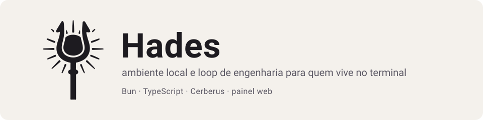
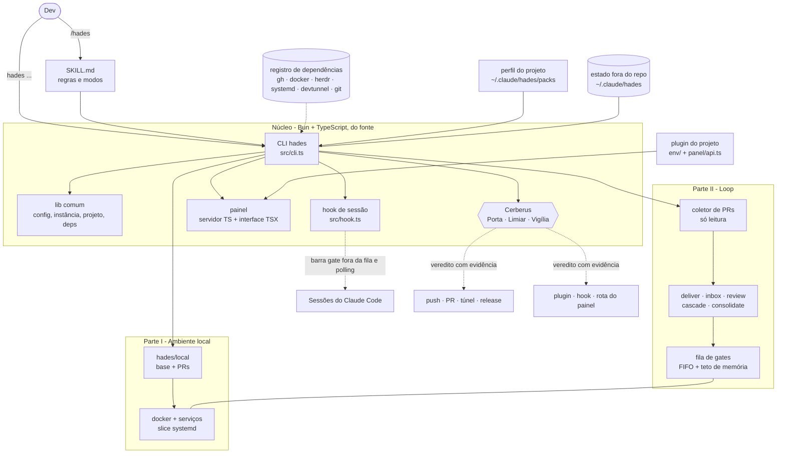

<p align="center">
  
</p>

# Hades

Uma skill do Claude Code que leva a spec até a PR, responde aos reviews e sobe o ambiente local das suas PRs. Nunca faz
merge e mantém a memória da máquina sob um teto.

Ela vive em `~/.claude`, atende qualquer clone e conhece cada projeto por um perfil, sem levar nada de projeto no núcleo.
Você usa por um comando (`/hades`), uma CLI (`hades`), um painel web e uma guarda (o Cerberus) que decide o que pode sair,
entrar e acontecer na máquina. Roda em Bun + TypeScript, do fonte, sem build. Versão atual em [`VERSION`](VERSION),
histórico em [`CHANGELOG.md`](CHANGELOG.md).

## O que ela faz

| Recurso | O que entrega | Detalhe |
|---|---|---|
| Loop de engenharia | spec até a PR, reviews recebidos, revisão de PRs de terceiros, cascata da stack e consolidação; para antes do merge, que é sempre seu | [Uso](#uso) |
| Fila de gates e teto de memória | tipos, testes e build um de cada vez, com orçamento de memória; um hook barra o gate que tenta furar a fila | [Arquitetura](#arquitetura) |
| Orquestração de agentes | agentes pelo herdr, um brief para cada, acompanhamento e auditoria; quem espera por você estaciona e volta depois | [`reference/loop/orchestrate.md`](reference/loop/orchestrate.md) |
| Ambiente local das PRs | a branch `hades/local` (base mais as PRs), infra em docker e serviços sob demanda, com snapshot dos bancos pelo plugin do projeto | [Primeiros passos](#primeiros-passos) |
| Painel web | loop, fila, consumo, logs e Configurações ao vivo, o herdr, terminais, um chat com o Claude Code e acesso de fora, também como PWA no celular | [`reference/panel.md`](reference/panel.md) |
| Cerberus | confere o que sai (Porta), o que entra (Limiar) e o que acontece dentro (Vigília), com veredito e evidência | [`reference/cerberus.md`](reference/cerberus.md) |
| Regras de qualidade | pacotes de regras de engenharia que você liga e desliga, injetados nos briefs; as do projeto valem por cima | [`reference/quality.md`](reference/quality.md) |
| Perfis de projeto e plugins | o que é de cada projeto fica num perfil; o plugin acrescenta ambiente, páginas e rotas, com prévia do que executa | [Projetos e plugins](#projetos-e-plugins) |
| Notificações e widget Android | aviso no desktop e no celular (ntfy) quando algo espera por você; o widget conta agentes ativos, parados e perguntando | [`reference/notify.md`](reference/notify.md) |
| Consumo de tokens | consumo por papel, agente e dia (`hades usage`), com modelo, esforço e teto de contexto por papel | [`reference/loop/tokens.md`](reference/loop/tokens.md) |
| Doctor e onboarding | `hades doctor` confere a instalação e diz o comando que corrige cada item; `/hades env onboard` entrega os passos que são seus | [Primeiros passos](#primeiros-passos) |

Garantias que não cedem a pedido: nunca faz merge, nunca faz push sem conferir o upstream, nunca pula hook, nunca
enfraquece teste, nunca declara verde um gate que não rodou e nunca escreve estado dentro do repositório do projeto (ele
vive em `~/.claude/hades/`).

## Requisitos

Linux com systemd é o alvo; o macOS é suportado via launchd (ver
[ADR 0001](reference/adr/0001-gerenciador-de-servico.md)). O Bun (>= 1.1) é a única dependência de runtime da CLI. As
demais ficam num registro único (`src/deps/registry.tsv`): o comando que precisa de uma falha cedo, com saída `69` e a
instrução de instalar. O `hades doctor` reporta erro para as obrigatórias e aviso para as que só um recurso usa.

| Dependência | Nível | Para quê |
|---|---|---|
| `bun` | obrigatória | CLI, hook e painel |
| `git` | obrigatória | clones, worktrees e branches |
| `gh` (logado) | obrigatória | PRs, reviews e checagem de versão |
| `jq`, `node`, `unzip` | obrigatórias | JSON dos registros, build do projeto e pacotes |
| `docker` com compose v2 | aviso (exigida se o projeto declara `env.pack`) | infra do ambiente do projeto |
| `systemctl`, `systemd-run`, `loginctl`, `journalctl` | aviso | units, slice de memória, timers, início automático e túnel |
| `herdr` | aviso | orquestração de agentes |
| `devtunnel` | aviso | túnel público do painel |
| `claude` | aviso | revisões de PR pelo painel |
| `bwrap` | aviso | ensaio dos scripts de plugin num sandbox, no Limiar do Cerberus |
| `curl`, `ss`, `notify-send`, `ufw` ou `firewall-cmd` | aviso | baixar o devtunnel, portas em uso, notificações no desktop e o comando de firewall sugerido |

Sem `systemd` o `doctor` avisa e o ambiente local (slice de memória, units) não sobe. O clone do projeto precisa ter
`origin` apontando para o GitHub e o `gh` logado: a Hades nomeia a fila de gates e o projeto pelo remote, e `hades prs`
consulta as PRs por ele.

```bash
hades deps                  # lista, com a instrução das ausentes
hades deps --json           # contrato version: 1, o mesmo que o painel consome
hades deps need gh docker   # sai 69 se faltar alguma
```

No macOS, antes de instalar:

```bash
brew install bash jq          # o /bin/bash do macOS é o 3.2; o kit precisa do 4+ primeiro no PATH
brew install coreutils        # só para rodar a suíte de testes (timeout, stat -c, sha256sum do GNU)
```

Diferenças no macOS: a fila de gates mede a memória pelo `kern.memorystatus_level` (o mesmo número do `memory_pressure`)
em vez do `MemAvailable` e roda sem teto de memória (não há `systemd-run`). O `hades logrotate` não confere se o log está
aberto sem `O_APPEND`, porque sem `/proc` não dá para ver as flags de quem tem o arquivo aberto.

## Instalação

A skill vive em `~/.claude/skills/hades`. Instale o Bun e clone o repositório nesse caminho:

```bash
curl -fsSL https://bun.sh/install | bash     # executa o instalador do Bun; confira o script em https://bun.sh
mkdir -p ~/.claude/skills
git clone https://github.com/The-Hades-Organization/Hades-Skill ~/.claude/skills/hades
```

Não há build nem `bun install` para rodar: a CLI executa do fonte (o `bun install` é de quem contribui). Crie o atalho
`hades`; a skill não grava alias no seu shell:

```bash
alias hades='bun ~/.claude/skills/hades/src/cli.ts'    # ponha no ~/.bashrc ou ~/.zshrc
```

Instale o ambiente a partir de um clone do projeto com `origin` no GitHub (sem ele o `install.sh` para com o erro
`não tem remote.origin.url`). Ele cria `<clone>-hades` na branch `hades/local`, os dados em `<worktree>-data` e a slice de
memória, liga o `rerere` e registra o hook da skill no `~/.claude/settings.json`:

```bash
cd <clone-do-projeto>
~/.claude/skills/hades/kit/install.sh
hades doctor
```

O `install.sh` também instala o comando `/hades` (`~/.claude/commands/hades.md`), é idempotente e nunca toca em estado ou
segredos já gravados. Várias instâncias convivem na mesma máquina, uma por projeto
(`HADES_ID=<id> HADES_WT=<worktree> kit/install.sh`), cada uma com units, slice, compose e porta de painel próprias.

### Atualizar

```bash
git -C ~/.claude/skills/hades pull
~/.claude/skills/hades/kit/install.sh
```

É o comando que o aviso de versão nova do painel e do `doctor` mostra quando o `VERSION` da `main` passa o instalado.

### Sem git

O pacote `hades-skill-v<versão>.tar.gz`, o mesmo que o `hades skill-release release` gera, já traz a pasta `hades/` na
raiz:

```bash
tar -xzf hades-skill-v<versão>.tar.gz -C ~/.claude/skills
```

Para atualizar, apague a pasta antiga antes de extrair o pacote novo; senão, arquivos removidos na versão nova ficam para
trás. O estado fica em `~/.claude/hades/`, fora dela, e não se perde.

### Testar com o mínimo de efeito na máquina

Instale numa pasta descartável:

```bash
export HADES_WT=<clone> HADES_DATA=/tmp/hades-teste
SKIP_SYSTEMD=1 SKIP_WORKTREE=1 SKIP_DOCTOR=1 ~/.claude/skills/hades/kit/install.sh
```

Esse modo não cria worktree, units nem slice e não registra o hook, mas ainda grava a configuração da instância
(`config.env`, portas, `HADES_ID`) em `HADES_DATA`. Mantenha `HADES_WT` e `HADES_DATA` exportados nos comandos seguintes:
é por eles que a CLI acha essa instância. O hook só entra no `settings.json` se você apontar `HADES_CLAUDE_SETTINGS` para
um arquivo seu.

## Primeiros passos

```bash
hades doctor                  # 1. pré-requisitos, máquina e instalação, com o comando que corrige cada item
hades project resolve         # 2. o projeto ativo e o perfil do repo atual
```

O passo 2 sai com `3` quando o repo ainda não tem perfil, o esperado na primeira vez: o passo 3 o cria. No Claude Code,
dentro do clone do projeto:

```text
/hades project init           # 3. gera o perfil do repo (só grava com o seu ok)
/hades env up                 # 4. sobe o ambiente local
/hades                        # 5. o loop: inbox primeiro e, se nada estiver acionável, deliver
```

A infra, os dados e os serviços do projeto (docker, seeds) vêm do pacote do projeto, o plugin com `env.pack` (veja
[Projetos e plugins](#projetos-e-plugins)). Sem plugin, o `install.sh` avisa que instala só a parte da máquina; você
ainda tem o painel, o loop, a fila de gates, o Cerberus, a qualidade e as notificações, mas o ambiente local das PRs
depende do plugin. Escreva ou instale um antes do passo 4.

Abra o painel:

```bash
hades panel serve --port 21220      # http://127.0.0.1:21220
```

Para ele subir com a máquina: Configurações → Painel → *Iniciar o painel automaticamente*.

## Uso

### No Claude Code (`/hades …`)

```text
/hades deliver SPEC-123            # leva a spec até a PR (para antes do merge)
/hades inbox --pr 4937             # trata os reviews recebidos nessa PR
/hades review --author fulano --max 3   # revisa 3 PRs do autor, em paralelo, como comentário
/hades cascade                     # propaga a stack: merge da base, rebase, conflitos
/hades orchestrate "migrar X"      # aloca agentes, escreve briefs, acompanha e audita
/hades consolidate 101 102 103     # junta as PRs numa só, com um gate único
/hades status                      # coletor + locks + escalações, só leitura
/hades usage --days 7              # consumo de tokens por papel e dia
/hades env up 4937 4959            # ambiente só com essas PRs
/hades env doctor                  # diagnóstico
/hades env onboard                 # o que falta configurar, recurso a recurso
```

`--dry-run` em qualquer modo que escreve produz plano e relatório locais e não publica nada.

| Modo | Faz |
|---|---|
| `deliver` | spec → código → gates → `/review-agents` → PR |
| `inbox` | triagem dos reviews recebidos nas suas PRs e correção dos achados vivos |
| `review` | revisa PRs de terceiros em paralelo e publica como comentário |
| `cascade` · `sweep` | cascata da stack de PRs nos quatro sentidos |
| `orchestrate` · `consolidate` | aloca agentes pelo herdr, junta PRs numa só, com gate único |
| `status` · `locks` · `answer` · `ready` · `watch` · `resume` | manutenção do loop |
| `usage` | consumo de tokens por papel, agente e dia |

Cada PR tem um estado (`ci-red`, `conflict`, `needs-response`, `done-pending`…) calculado por um coletor só de leitura. O
loop sabe o que fazer a seguir e para em `done-pending` (tudo pronto, esperando você): o merge é seu.

### Na linha de comando (`hades …`)

```bash
hades doctor --quick                          # diagnóstico rápido (exit 0 ok · 1 erro · 2 avisos)
hades prs add 4937 && hades prs show          # conjunto de PRs do ambiente local
hades rebuild-branch                          # reconstrói hades/local: base + PRs
hades gate-lock run test --label meu-agente -- bun test    # gate pela fila de admissão
hades gate-lock status                        # quem roda e quem espera, com a memória de cada gate
hades wait ci 4937                            # espera o CI e sai com uma linha (rode em segundo plano)
hades pr-loop-state --json --author @me       # estado de cada PR do loop (só leitura)
hades quality list                            # regras de qualidade ligadas, injetadas nos briefs
hades cerberus modos                          # modo de cada cabeça do Cerberus
hades cerberus historico                      # o que cada guarda barrou
hades config show                             # Configurações; `config set K=V` altera
hades clean status                            # logs e disco; `clean run --dry-run` mostra o que liberaria
hades notify test                             # notificação no desktop e no celular (ntfy)
hades usage --days 7 --json                   # consumo de tokens
hades plugins list                            # pacotes de plugin instalados
```

Sem argumento, `hades` imprime a lista de subcomandos. Argumentos e códigos de saída de cada um:
[`reference/cli.md`](reference/cli.md).

### Cerberus e painel

O Cerberus tem três cabeças, cada uma com um veredito e a evidência dele:

| Cabeça | Observa |
|---|---|
| Porta | o que sai da máquina: push, comentário de PR, artefato, túnel, release |
| Limiar | o que entra: plugin, `post-install.sh`, hooks, páginas e rotas do painel |
| Vigília | o que acontece dentro: auditoria do DONE, coerência entre plano, registro e realidade |

Cada cabeça tem um modo (`barra` ou `avisa`) em Configurações; exceção e mudança de modo só você abre.

O painel escuta em `http://127.0.0.1:21220` (porta configurável). Tem páginas como Visão geral, Branch e PRs, Fila de
gates, Consumo, Orquestração, Revisões, Loop, Herdr, Logs, Notificações, Onboarding, Plugins, Qualidade, Cerberus e
Configurações, mais a página Claude: um chat com o Claude Code, também pelo celular (PWA) por um túnel.

## Arquitetura



A Hades tem duas partes que dividem a fila de gates, as Configurações e o painel:

- Parte I, ambiente local: roda o estado mais recente de um conjunto de PRs para validação manual. Branch `hades/local`
  (base do projeto mais as PRs, reconstruída em ordem topológica), infra em docker própria, serviços sob um teto de
  memória, dados e processos de apoio do projeto, painel e túnel. O ambiente cede: se um gate pesado espera memória, ele
  pausa sem perder dados e volta quando a fila esvazia.
- Parte II, loop de engenharia: orquestra o que já existe, em vez de reescrevê-lo (modos na tabela de [Uso](#uso)).

A skill é global e o projeto é um perfil. Estado, locks e relatórios ficam em `~/.claude/hades/`, por repositório e não
por clone, e nunca dentro da árvore do projeto. A fila de gates é única para o loop e para o ambiente: um gate pesado por
vez, com orçamento de memória. Detalhes em [`reference/architecture.md`](reference/architecture.md).

| Onde | O quê |
|---|---|
| `src/` | a CLI `hades`, a lib comum, o hook e o painel |
| `kit/` | a parte da máquina: instalação, configuração, diagnóstico, onboarding, túnel, notificações |
| `loop/` | coletor de PRs, esquemas, Cerberus (guardas) e testes |
| `reference/` | uma referência por assunto (painel, projetos, Cerberus, qualidade, túnel…) |
| `quality/` | catálogo de regras de qualidade (`base.json`) e pacotes |
| `stacks/` | pacotes de stack (como o hook e a fila medem e classificam um gate) |

## Configuração

Os parâmetros ficam no `config.env` da instância, com padrões em `kit/config.tsv`; ninguém edita o arquivo à mão:

```bash
hades config show                          # todas as chaves, valor e descrição
hades config get HADES_SLICE_MAX
hades config set HADES_SLICE_MAX=4G        # grava; pela CLI o que exige reinício é aplicado à parte (o painel aplica)
hades config export                        # leva suas configurações para outra instalação
hades config import <arquivo> --dry-run
```

O mesmo está no painel, em Configurações (com busca, exportar e importar). Algumas chaves:

| Chave | Efeito |
|---|---|
| `HADES_SLICE_MAX` · `HADES_SLICE_HIGH` | teto e pressão de memória de tudo o que o Hades roda |
| `HADES_PANEL_PORT` · `HADES_PANEL_AUTOSTART` | porta e início automático (`off`, `login` ou `boot`) do painel |
| `HADES_NOTIFY` · `HADES_NOTIFY_NTFY` | notificações no desktop e no celular |
| `HADES_CHAT` | liga e desliga o chat com o Claude no painel |
| `HADES_CEDE` | liga e desliga a regra de o ambiente ceder a um gate que espera memória (`0` desliga) |
| `HADES_CERBERUS_*` | modo e limites de cada cabeça |

Variáveis de ambiente úteis: `HADES_WT` (worktree), `HADES_DATA` (pasta de dados), `HADES_WORK_ROOT` (raiz do estado do
loop), `HADES_BUN` (outro executável do Bun) e, para a release, `HADES_NAME_GUARD` e `HADES_DOMAIN_GUARD` (`report` ou
`strict`: guardas de nome de projeto e de domínio).

Para mudar o combinado de memória, desligue a regra de ceder (`HADES_CEDE=0`), peça uma exceção ao Cerberus ou, se você
sabe que não há outra sessão rodando, libere a fila no pedido.

Qualidade: o catálogo traz regras genéricas de engenharia (linguagem, framework, práticas, estilo, testes, banco), em
pacotes que você liga e desliga (`hades quality on|off [--pack <id>]`). As ligadas entram nos briefs e nas fases do loop;
as do projeto vêm do perfil e valem por cima. Ver [`reference/quality.md`](reference/quality.md).

Acesso remoto: o painel de fora passa por um devtunnel. A Hades prepara o túnel e entrega os comandos; publicar o acesso
e fazer login são passos seus, e o painel ainda exige a chave. Ver [`reference/tunnel.md`](reference/tunnel.md) e
`hades onboard`.

## Projetos e plugins

O núcleo não conhece projeto: o texto específico (fluxo de entrega, gates, invariantes, vocabulário, ambiente) mora num
pacote de projeto, e o `profile.json` dele diz o que o núcleo deve ler. O projeto ativo é o do repo do diretório atual
(`remote.origin.url` → perfil em `~/.claude/hades/packs/`).

```bash
hades project resolve        # qual projeto, qual perfil (sai 3 sem perfil, 4 fora de repo)
hades project validate       # confere o perfil
hades project core-check     # a faixa `core` do perfil contra a versão do núcleo
```

Um pacote pode ser um plugin: acrescenta ao núcleo o ambiente do projeto (`env/`: infra, dados, serviços), páginas e
rotas do painel e diagnósticos. O contrato:

- o perfil declara a faixa `core` que suporta; desde a 5.0.0 o contrato exige `core >=5`, e o `install.sh` recusa núcleo
  fora da faixa;
- as rotas e ações do painel vêm de `panel/api.ts`, carregado uma vez por um host em processo à parte; os tipos estão em
  `src/panel/plugin-api.ts`;
- páginas em `panel/ui/`, diagnósticos em `doctor.sh` e `checks/`.

Instalar, atualizar e desligar passa pela página Plugins do painel ou por `hades plugins add <url>`, `update`, `enable`,
`disable` e `remove`, sempre com a prévia do commit e do que vai executar, e pelo Limiar do Cerberus. Para escrever o
primeiro perfil, use `/hades project init`; os formatos estão em [`reference/projects.md`](reference/projects.md).

## Contribuição

Issues e PRs são bem-vindas. O caminho completo, do fork à PR, está no [`CONTRIBUTING.md`](CONTRIBUTING.md). Para bug ou
pedido, abra uma issue pelos modelos; para vulnerabilidade, siga o [`SECURITY.md`](SECURITY.md), nunca uma issue pública.

## Segurança

A Hades roda com as suas permissões, na sua máquina. O Cerberus barra e avisa, mas não é um sandbox: o que você instala e
aprova (o `curl … | bash` do Bun, o `post-install.sh`, os plugins) executa como você. Estado, locks e configuração ficam
em `~/.claude/hades/`, e o hook e o comando em `~/.claude/settings.json` e `~/.claude/commands/hades.md`, mais as units,
a slice e os timers de usuário do systemd; nada dentro do repositório do projeto.

Com o túnel do painel no ar, o painel, o chat e os terminais ficam ao alcance de quem passa pelas duas camadas (a conta
dona do túnel e a chave de acesso): trate a chave como uma senha de shell. O painel escuta só em `127.0.0.1`, confere
`Host` e `Origin` e roda o chat sempre em `--permission-mode auto`. O modelo de ameaça, camada por camada, e como reportar
uma vulnerabilidade em privado estão no [`SECURITY.md`](SECURITY.md).

## Glossário

- A Hades é a skill (o que você instala em `~/.claude/skills/hades`); o Hades é o ambiente local no ar (branch, infra,
  serviços e painel).
- Você é quem instala e opera; o mantenedor da skill revisa as contribuições e publica as versões.
- Gate é uma checagem pesada antes da PR (tipos, testes, build) que passa por uma fila com teto de memória.
- Spec é a especificação escrita do que entregar; stack de PRs é uma cadeia de PRs em que cada uma parte da anterior.
- herdr é o multiplexador de agentes do terminal que a Hades usa para orquestrar.
- Slice é o grupo de memória do systemd em que tudo o que o Hades roda fica contido.

## Licença

Distribuída sob a [licença MIT](LICENSE), Copyright (c) 2026 Hadson Ramalho.

O painel redistribui bibliotecas, fontes e código de terceiros (React, lucide-react, marked, mermaid, htm, motion,
Tailwind, Figtree, Geist Mono, Marcellus, o tour de tonghohin, o Number Ticker do Magic UI e o padrão de componentes do
shadcn/ui), cada um sob a própria licença. A lista, com versão, origem e o texto de cada licença, está em
[`THIRD_PARTY_NOTICES.md`](THIRD_PARTY_NOTICES.md).
